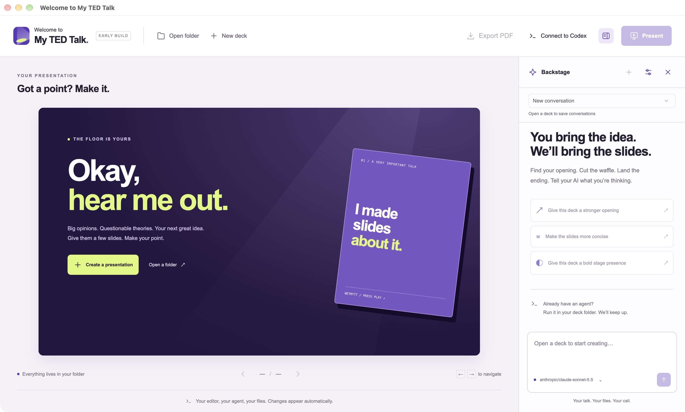
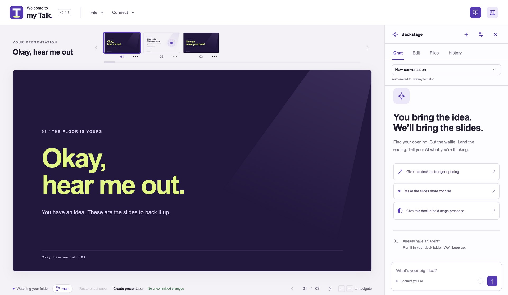
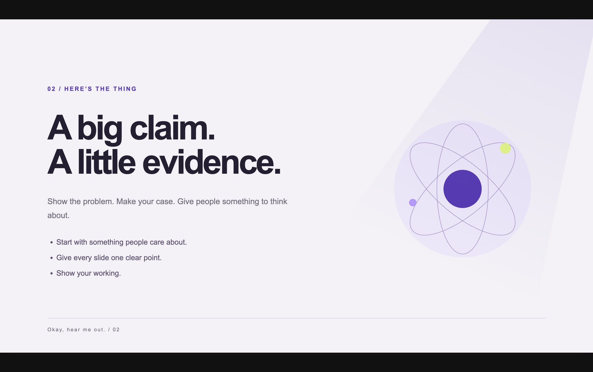

# Welcome to My TED Talk

**Got a point? Make it.**

`wetmytt` for short. A playful nod to the familiar “welcome to my TED talk” sign-off, with its own violet-and-lime stage identity. An independent project, not affiliated with TED. This is an early build.



## What it does

Welcome to My TED Talk is a local desktop app for HTML slide decks. A deck is a folder of files. You describe the talk, an AI edits those files, and you present from the same window or export a PDF to share.

## The problem

I need HTML slides without the usual project ritual:

- creating a new project folder by hand
- opening an IDE inside it
- adding that folder to Codex
- opening a terminal there to run Codex CLI

The slides have to be HTML. The interface only needs a minimal way to work with them, because most of the editing is done by AI. It has to be local first, easy to present from, and easy to export to PDF when I want to share a copy. And it has to stay simple.

## The solution

This app. **New deck** creates the folder and a starter HTML presentation. The built-in chat, **Connect to Codex**, or **Connect to Claude** does the editing against that folder. **Present** puts the slides on screen. **Export PDF** writes a file you can send.



*The workspace: your slides on the left, your creative partner on the right.*

## Features

- **HTML slides, as files.** Each deck is a folder: `index.html`, `deck.json`, `slides.js`, `styles.css`, and `assets/`. The same folder opens here, in an editor, or with any agent that can write files.
- **AI-first editing.** The window is a slide preview plus a chat sidebar. Bring your own key for OpenAI, Claude, or OpenRouter, or point it at a local Ollama model. The agent reads and writes the deck, and can run commands when the work needs them.
- **Click to edit text.** Select text on a slide to highlight it and open its JSON field in the sidebar's **Edit** tab. Keys become labels; values are editable text. Save each field to update the preview.
- **A small set of controls.** Create or open a folder, move between slides, present, export, and show the files on disk.
- **Local first.** The deck stays in the folder you chose. Provider settings stay in the app. Conversations are saved inside the deck at `.wetmytt/chats/`.
- **Present.** Full screen, with the shell hidden. Arrow keys or the on-screen controls move between slides. Esc leaves presentation mode.
- **PDF export.** **Export PDF** prints each live slide to a 16:9 page. Text stays selectable, and fonts, SVG, and backgrounds come along.
- **Codex from the toolbar.** **Connect to Codex** points Codex at the deck already open in the app, through a local plugin. The deck folder is the working folder.
- **Caught up with every edit.** The app watches the deck folder and reloads when files change, including edits from another agent or editor. Drop images onto the window to copy them into `assets/`.

## Run

Requires Node.js 22.12+ and npm.

```sh
npm install
npm run dev
```

This starts Next.js on `127.0.0.1:3210`, waits for it, then launches Electron. The Next.js shell has hot reload. To use the static production shell:

```sh
npm run build
npm start
```

`npm run dev:web` previews the UI in a browser; folder access and AI require Electron. `npm start` uses the existing `out/` build. For signed Apple Silicon and Intel DMGs, see [Building and releasing macOS installers](docs/releases.md).

## Make a deck

Choose **File → New deck** and choose a new folder name, or **File → Open folder** for an existing deck with `index.html`. A new deck copies the editable starter:

```text
my-presentation/
  AGENTS.md      # guidance for agents editing the deck
  deck.json      # structured content
  index.html     # actual slide entry point
  slides.js      # JSON → slide HTML
  styles.css     # all deck styling
  assets/        # images and other local resources
```

`deck.json` contains a title and slides with `title`, `eyebrow`, `body`, optional `bullets`, optional `image` / `imageAlt`, and `layout` (`cover`, `split`, `closing`). HTML, CSS, rendering code, and content are all yours to change. Use relative asset URLs. No resources are fetched from the internet by the deck preview.

The **Edit** tab lists string values in `deck.json`, including nested objects and arrays. Clicking slide text opens and focuses the matching field. Starter decks bind text elements with `data-json-path="/slides/0/title"` (a JSON pointer). Custom renderers can use the same attribute; escape `~` as `~0` and `/` as `~1` within key names. Existing decks fall back to unique text matches, preferring the current slide. Repeated or transformed text needs an explicit binding. Text without a match can still be selected; choose its field in Edit. Decks without `deck.json` need a JSON source and bindings to use this editor.

**Save text** writes the field to disk and refreshes the preview. Unsaved drafts stay while switching tabs or selecting other fields. If `deck.json` changes externally before saving, the editor preserves the draft and asks you to reload instead of overwriting those changes. **Discard edits & reload** loads the current file. Selection highlights are hidden during presentation and PDF export.

**File → Open recent** and the welcome screen list the last ten successfully opened or created folders, newest first. History stays in the app’s local user-data directory across restarts. Remove an entry or clear the list without changing the folders on disk. If a folder has moved or is unavailable, opening it reports an error and keeps your current presentation open.

The app watches the complete deck folder for changes, including images and nested assets, and reloads while retaining the current slide where possible. Hidden files and `node_modules` are ignored. A temporarily invalid JSON file displays an error in the slide area; saving valid JSON recovers automatically.

With a project open, drag files anywhere onto the app (including the slide preview) to copy them into its `assets/` folder. You can also choose **File → Add assets** to choose multiple files. Originals stay in place, and duplicate names get a numbered suffix instead of overwriting existing assets. Folders and files over 25 MB are not imported. Agents can use `import_assets` with absolute local paths or `download_asset` with a public URL and filename; both return relative paths for use in the slides.

Click a thumbnail beside the presentation name to jump to a slide. The current slide is highlighted and stays visible as you navigate. Scroll the strip with a trackpad, its chevrons, or the seeker underneath; edge fades indicate more slides. Previews load as needed and refresh when the deck changes. **File → Show files** opens the presentation folder.

Use the visible arrows or **← / →** to navigate. With a thumbnail focused, **Home / End** jumps to the first or last slide. **Present** enters full screen with the shell hidden; **Esc** exits. A hidden exit button also appears on hover at the top right. Hide or show the chat sidebar with the top-right panel button. Navigation keys do not interfere with typing in chat.



*Presentation mode gives the slide the stage.*

### Custom slide HTML

Mark each slide container with `data-slide`, keep a closing `</body>` tag, and respect `[hidden] { display: none !important; }`. Welcome to My TED Talk injects a small bridge that counts those containers, hides inactive slides, and communicates navigation with the shell. It does not prescribe the HTML structure inside a slide. The default renderer reads JSON, but custom HTML can use any local rendering approach.

Each slide can have its own HTML, CSS, JavaScript, animations, SVG, canvas, and interactions; the starter layouts and JSON schema are examples. Use browser-ready local code: the sandbox has no Node.js, Electron APIs, backend, remote resource/API access, or dynamic code evaluation (`eval` / `new Function`). Design for the 16:9 canvas (1280 × 720 for capture/export). Keep text in `deck.json` with bindings when you want the Edit tab to work, and provide useful static states for PDF export.

These authoring capabilities and requirements are supplied to built-in chat, MCP initialization and presentation-selection responses, and generated Codex/Claude connector descriptions. New decks also receive them in `AGENTS.md`; existing decks' instructions are left intact. Agents are instructed to inspect files and read `AGENTS.md` if present before editing. Regenerate and refresh/reinstall existing connector packages to update their displayed descriptions; the running MCP server supplies current guidance after an app restart.

## AI: bring your own key

Open **AI settings**, choose **OpenRouter**, **OpenAI**, **Claude**, or **Ollama**, and enter a model ID that supports tools. Cloud connections require an API key; local Ollama does not. OpenAI, OpenRouter, and Ollama use Chat Completions; Claude uses the Anthropic Messages API. OpenRouter routing requires support for the requested parameters. The advanced base URL supports proxies using the selected API format, with HTTPS required except for loopback servers. Changing providers or endpoints does not reuse the saved key. Saving validates the configuration locally; model access and tool support are checked when you send a message.

The built-in agent and MCP connections share dedicated tools for listing, reading, writing, and patching text files; web search and page retrieval; asset imports and downloads; and local Git history. Neither interface exposes arbitrary shell commands. Changes are applied directly and auto-reloaded. There is no built-in image generation; agents can download assets or write SVG.

`search_web` retrieves DuckDuckGo HTML results without an API key, curl installation, or search subscription. It returns titles, source URLs, and snippets, with a one-minute cache. Public search may return a challenge or change its markup; those cases produce an explicit error rather than invented results. `fetch_url` extracts readable text from public HTTP(S) pages without executing JavaScript. Requests have a 30-second deadline, at most five redirects, and bounded response sizes. Page text is capped at 40,000 characters; binary downloads use `download_asset` instead. Private network URLs and URLs containing credentials are rejected.

New decks automatically initialize a local Git repository on `main` and receive a **Create presentation** commit. Existing folders are left unchanged until `git_init` is explicitly called. Git is bundled with the desktop app, so users do not need to install it. Commits use configured Git name/email where present, falling back to **Welcome to My TED Talk <wetmytt@users.noreply.local>** for missing values, without editing global configuration. The default ignores exclude `.wetmytt/` chat history, `node_modules/`, and `.DS_Store`. Use explicit file paths to stage changes; `.gitignore` is supported. Git tools provide local status, diff, log, stage, unstage, commit, branch, switch, and restore operations. They do not fetch, push, run hooks or filters, or accept arbitrary Git arguments. `git_restore` discards unstaged edits to the specified tracked files. Linked worktrees and repositories stored outside the deck are not supported.

`apply_patch` accepts unified diffs with `---` / `+++` file headers and numbered `@@` hunks. Use `a/path` and `b/path`, or `/dev/null` for additions and deletions; different old/new paths rename a file. All changes are validated before writing, including JSON validity, destination collisions, path restrictions, and matching source text. Text files and patches are limited to 1 MB. A repository is not required. Calls from built-in chat and MCP are serialized per presentation to avoid interleaving patch and Git mutations.

Keys stay in Electron's main process and are encrypted at rest using Electron `safeStorage`. If OS encryption is unavailable, the key is kept in memory only. Provider settings are stored in Electron's user-data directory, never in the deck. Chat conversations are automatically saved as JSON files inside each presentation at `.wetmytt/chats/<conversation-id>.json` (inside the deck folder, not your home directory). Each log includes a version, title, timestamps, messages, and per-request provider, model, base URL, and completion/failure/cancellation status; API keys are never included. Prompts are saved before the provider request, so failed or stopped requests remain in history. Opening a deck restores its latest conversation. Use the **+ New conversation** button in the chat header to clear the active context, or the saved-conversations picker to resume an older chat. New conversations preserve existing logs and use the currently selected provider and model when continued. The latest 100 messages are sent as context. Chat logs contain conversation text in plain text; they are excluded from the deck preview and file tools, and are ignored by new repositories. A request still marked `running` after an app crash was interrupted before its final status could be saved. The model receives your chat, files it reads, and command output. Stop cancels the running chat and its network/Git operations; completed writes remain. Each chat is limited to 16 model turns, with a three-minute deadline for each model call.

## External agents and MCP

Hide chat and run your agent directly:

```sh
cd /path/to/my-presentation
codex
```

Welcome to My TED Talk does not need to launch or supervise the agent. Changes from any editor or agent appear automatically.

### Connect Codex to the running app

The Electron app hosts a Streamable HTTP MCP endpoint at `http://127.0.0.1:43187/mcp` while it is running. No presentation contains server code, and clients do not need a path to this app's installation.

1. Start the app and open a presentation.
2. Choose **Connect → Connect to Codex** in the toolbar. The app prepares a private local plugin and opens its details in Codex Desktop.
3. Select **Install** in Codex, then start a new Codex chat and use the **Welcome to My TED Talk** plugin.

No manual MCP configuration is needed. If the plugin doesn't appear immediately, restart Codex and click **Open in Codex** in the connection dialog. Codex remains responsible for the final installation and enablement; the app does not silently install the plugin or change tool approval settings.

The app creates its plugin under `~/.agents/plugins/wetmytt/` and adds an entry to `~/.agents/plugins/marketplace.json`, preserving other entries and marketplace metadata. The plugin includes its name, icon, and the authenticated local MCP endpoint. The connection button opens a `codex://plugins/wetmytt?marketplacePath=...` link to that personal marketplace. Repeated use refreshes the same plugin source without adding duplicate entries. Existing installed copies may need to be refreshed or reinstalled through Codex after changing credentials.

The access token is generated once and stored with owner-only permissions in `mcp-token` in Electron's user data directory. It remains valid across app restarts. The generated plugin folder is private to your user, and its `.mcp.json` is owner-readable/writable because it contains the token. Keep this generated package local; do not share or commit it. To revoke the token, quit the app, remove that token file, restart, click **Connect to Codex**, and reinstall the plugin in Codex to refresh its cached credentials.

If you previously added `[mcp_servers.wetmytt]` to Codex's config manually, remove that old entry after installing the plugin to avoid duplicate connections. The app preserves your existing Codex configuration.

The endpoint binds only to `127.0.0.1`, checks Host and Origin headers, and requires the token on every request. Only one app instance runs at a time. If the fixed port is occupied, the app still opens and the connection dialog reports the error; free the port and restart the app.

### Connect Claude to the running app

Choose **Connect → Connect to Claude** in the toolbar. The app prepares a private `wetmytt.mcpb` extension and opens it for installation in Claude Desktop. Follow Claude's installation prompts, then start a new chat and enable the **Welcome to My TED Talk** tools. Keep this app running with a presentation open.

If the installer doesn't open, use Claude Settings → Desktop app → Extensions → Advanced settings → Install Extension and select the file shown in the connection dialog. This follows [Claude's custom desktop extension installation flow](https://support.claude.com/en/articles/10949351-getting-started-with-local-mcp-servers-on-claude-desktop). The extension uses Claude's bundled Node.js runtime; no separate Node installation is needed.

The package lives in the app's user data directory under `claude-extension/wetmytt.mcpb`. It contains a standalone stdio-to-HTTP bridge and the local access token, so keep it private. The app does not modify Claude's configuration or approve tools on your behalf. Repeated clicks refresh the same package; reinstall it in Claude after rotating the token. After opening or switching presentations, ask Claude to call `get_presentation` to select the open deck; the extension can stay connected. The bridge restores sessions lost after an app restart or idle expiry. It requires `get_presentation` before continuing presentation operations and does not automatically replay edits. After updating the bridge, click **Connect to Claude** and reinstall the extension to update Claude's installed copy.

Tools available through MCP (Codex and Claude), with the same editing, research, asset, and Git tools in built-in chat:

- `list_recent_presentations`: lists up to ten recently opened presentations, newest first, as `{ root, name, current }` entries. Works with no presentation open.
- `open_presentation`: accepts `{ "path": "/absolute/path/to/presentation" }` to open an existing folder and select it for subsequent tools in the calling session. Uses the same validation, live preview, and recent history as opening through the app. The folder must contain an `index.html` file.
- `get_presentation`: selects and identifies the currently open presentation for subsequent tool calls.
- `list_files`, `read_file`, `write_file`, `apply_patch`: edit text within the presentation folder, with path and symlink restrictions.
- `search_web`, `fetch_url`: search DuckDuckGo without an API key and retrieve readable public pages.
- `import_assets`, `download_asset`: copy local source files or download public URLs into `assets/`, preserving existing names with numbered suffixes. Maximum 25 MB per file.
- `git_init`, `git_status`, `git_diff`, `git_log`, `git_stage`, `git_unstage`, `git_commit`, `git_branch`, `git_switch`, `git_restore`: manage local project history using bundled Git.
- `screenshot_slide`: accepts `{ "slide": 2 }` and returns a 1280×720 PNG of the second slide directly to the model.

Use `list_recent_presentations` and `open_presentation` to choose a deck without using the app’s folder picker. Recent entries may be unavailable; a failed open keeps the current deck selected. Opening a deck through MCP selects it for the calling session. Other sessions must refresh their selection.

Each session initially selects the presentation open at initialization. After opening, switching, closing, or reopening a presentation outside the calling MCP session, call `get_presentation` to select the current deck in the same session. This also works for connections made before a deck was opened. Other presentation tools return a reminder to call `get_presentation` until the selection is refreshed. Switching or closing projects cancels pending network/Git operations. Completed writes remain in their original folder; operations never redirect into a new presentation.

Screenshots use isolated hidden windows inside the running Electron app. They wait for slide containers, images, and fonts, report invalid slide numbers or rendering timeouts, and leave the visible preview and presentation folder untouched. Sessions expire after 30 minutes without requests; reconnect if needed. Quitting the app stops MCP. Neither MCP nor built-in chat exposes terminal execution.

The former standalone stdio command (`npm run mcp` / `node electron/mcp.js`) has been replaced by this app-hosted endpoint. Remove its `command` and `args` configuration when migrating.

## Architecture and checks

- `app/`: Next.js App Router interface, exported as static HTML for production.
- `electron/tools.js`: shared validated tool registry for built-in chat and MCP. `git.js`, `patch.js`, and `web.js` implement dedicated operations.
- `electron/main.js` and `preload.cjs`: native dialogs, watcher, isolated IPC, settings, and agent orchestration.
- `electron/server.js`: loopback HTTP serving; decks have separate origins and random URL prefixes, with local-only CSP.
- `electron/bridge.js`: injected deck navigation protocol.
- `electron/files.js`: shared folder-scoped file tools, with traversal and symlink checks.
- `electron/agent.js` and `mcp.js`: BYOK tool loop and app-hosted HTTP MCP server.
- `electron/codex-plugin.js`: private local plugin generation, personal marketplace registration, and Codex deep link.

```sh
npm test
npm run typecheck
npm run build
npm run test:screenshot
```

The preview is sandboxed without Node integration, and IPC validates that calls come from the main application frame. File tools reject hidden paths and paths or symlinks outside the deck. Dedicated asset imports can read absolute local source paths supplied by the agent and copy them into `assets/`. Web tools retrieve public URLs; Git operations are restricted to the presentation repository, with hooks, external diff programs, signing, and configured filters disabled. This is a local desktop prototype; avoid opening untrusted folders or allowing concurrent untrusted processes to replace symlinks during writes.

Presenter notes, a separate presenter view, and selecting slide elements for editing are intentionally deferred.

## PDF export

Open a presentation and choose **Export PDF** in the toolbar. Choose a destination in the save dialog; canceling leaves files unchanged. The app reports completion or an asset/rendering error, and prevents overlapping exports.

Export uses Chromium's `printToPDF` on each live slide and combines the resulting PDF pages without rasterizing them. Text stays selectable, embedded fonts and SVG paths stay sharp, and slide backgrounds are included. Each page uses the app's widescreen 16:9 canvas (1280 × 720 CSS pixels, or 13⅓ × 7½ inches), with zero margins and no printer headers or footers. Existing raster images and canvas content retain their original resolution.

The export window uses the same 1280 × 720 presentation viewport as slide capture and the same local-only resource policy as the preview. It waits for the navigation bridge, images (including CSS backgrounds), and fonts; failed assets stop export instead of silently producing incomplete pages. Finite animations finish before printing; repeating animations pause. Keep `data-slide` on slide containers and the closing `</body>` tag for the navigation bridge. The preview and selected slide are unaffected. Videos and interactive content export their current static appearance.

Run `npm run test:pdf` to test PDF export through the actual Electron app, including its UI, bridge, save dialog handling, and Chromium rendering.

Run `npm run test:edit` after `npm run build` to test text selection, JSON field focus, saving, preview refresh, and external edit conflicts in the actual Electron app.

## License

Licensed under the [MIT License](LICENSE). Copyright (c) 2026 Ashwin Narayan.
